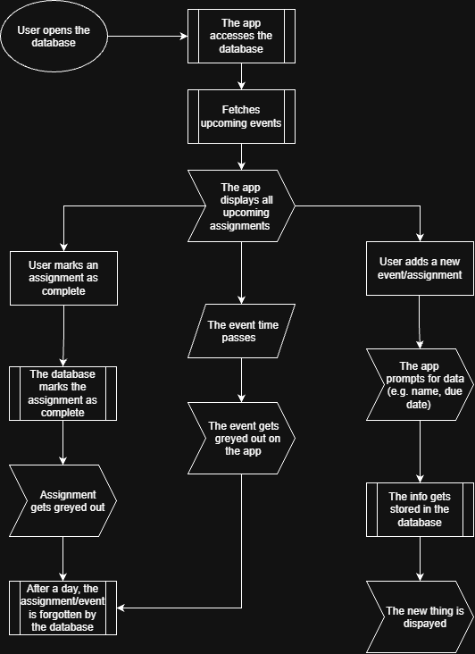

# Aether

A streamlined way to keep track of assignments and events so you stay on top of your game.

## The Problem

There was never a calendar that I was satisfied with, but I needed a way to track my events and assignments. So I decided to make my own with the contents and features I wanted

## How It Works

- Allows the creation of assignments and events
- Displays upcoming events
- Deletes assignments a day after they're completed/time passed



## Tech Stack

- **Language:** Javascript, C
- **Libraries:** React, SQLite, date-fns
- **External tools:** Electron Forge,

## Setup

Prerequisites:
- Node.js and npm
- Git
- A C/C++ build toolchain with Python (such as VSCode)

```git
git clone https://github.com/Henry-F-N/Aether_calendar.git
cd Aether_calendar
```

In the terminal

```
npm install
npm start
```

if you recieve a module not found error, run

```
npx electron-rebuild
```

## Usage

When the app is running, you can enter the components into the input fields and click submit,after which the assignment will appear in the field below.

Note: Be sure to enter the due date in the form yyyy/MM/dd, or else the app will not accept it

Example:
Name: Test
Due date: 2026/12/31
Description: this is a test

Once you have clicked submit, the assignment should pop up in the assignment field below, where you can delete it just by clicked the check box next to its name.

## Roadmap


- [ ] Desktop notifications
- [ ] Visually aesthetic
- [ ] Import deadlines from Brightspace

## Author

Henry Niemann https://github.com/Henry-F-N
